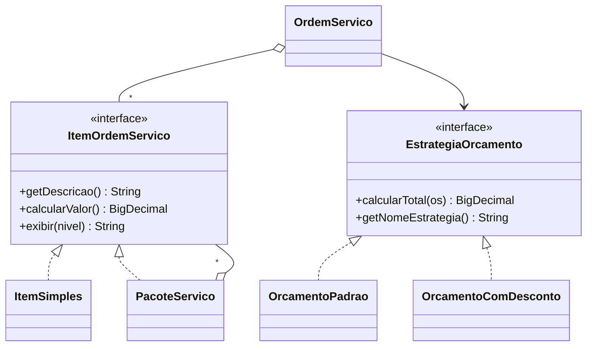

# Oficina Mecânica: Design Patterns (Composite + Strategy)

## Descrição do sistema

Aplicação Java de console para ordens de serviço (OS) de uma oficina mecânica. Cada OS pertence a um
veículo e reúne peças, serviços e pacotes (que podem conter outros pacotes). O valor final é calculado
por uma regra de orçamento que pode ser trocada em tempo de execução. Tudo é mantido em memória.

## Tecnologias e pré-requisitos

- Java 17+
- Maven: não precisa instalar, o projeto inclui o Maven Wrapper (`mvnw`)
- JUnit 5 (somente testes, baixado pelo Maven)
- Opcional: VS Code com o *Extension Pack for Java*

## Como executar

```bash
git clone https://github.com/Theordep/oficina-mecanica-patterns.git
cd oficina-mecanica-patterns
./mvnw compile exec:java   # executa a aplicação
./mvnw test                # roda os testes
# no Windows, use mvnw.cmd
```

No VS Code, abra `Main.java` e clique em **Run**.

Se o terminal do Windows exibir os acentos incorretamente, rode antes no PowerShell:

```powershell
chcp 65001
$env:MAVEN_OPTS="-Dfile.encoding=UTF-8 -Dsun.stdout.encoding=UTF-8"
```

## Exemplo de uso

```java
Veiculo veiculo = new Veiculo("ABC-1D23", "Fiat Argo", 2021, "João Silva");
OrdemServico os = new OrdemServico(1, veiculo);

PacoteServico freios = new PacoteServico("Freios");
freios.adicionarItem(new ItemSimples("Pastilha de freio", ItemSimples.Tipo.PECA, new BigDecimal("89.90"), 2));
os.adicionarItem(freios);

os.calcularTotal();                                      // orçamento padrão
os.trocarEstrategia(new OrcamentoComDesconto(BigDecimal.TEN));
os.calcularTotal();                                      // com 10% de desconto
```

### Saída da aplicação

```text
OS #1 | ABC-1D23 - Fiat Argo (2021) - Prop.: João Silva | 3 item(ns) | Estratégia: Orçamento Padrão

- Bateria 60Ah (PECA) x1 = R$ 420,00
- Alinhamento e balanceamento (SERVICO) x1 = R$ 150,00
- Pacote: Revisão de 30.000 km = R$ 528,80
  - Óleo 5W30 (litro) (PECA) x4 = R$ 194,00
  - Filtro de óleo (PECA) x1 = R$ 35,00
  - Pacote: Freios = R$ 299,80
    - Pastilha de freio (PECA) x2 = R$ 179,80
    - Troca das pastilhas (SERVICO) x1 = R$ 120,00

Subtotal: R$ 1.098,80
Orçamento Padrão: R$ 1.098,80
Orçamento com Desconto (10,0%): R$ 988,92
```

## Entidades

| Entidade do enunciado | No código |
|---|---|
| Veículo | `model.Veiculo` |
| OrdemServico | `model.OrdemServico` |
| Item | interface `composite.ItemOrdemServico`, implementada por `ItemSimples` e `PacoteServico` |

## Padrões de projeto utilizados



### Composite

**Problema:** a OS precisa cobrar tanto itens avulsos quanto pacotes com vários níveis, sem tratar cada
caso com condicionais.

| Papel | Classe |
|---|---|
| Component | `ItemOrdemServico` |
| Leaf | `ItemSimples` |
| Composite | `PacoteServico` |
| Client | `OrdemServico` |

`PacoteServico` calcula e exibe seu conteúdo recursivamente, e rejeita ciclos (um pacote não pode conter
a si mesmo, direta ou indiretamente).

### Strategy

**Problema:** a forma de calcular o valor final varia, e cada nova regra não deve exigir mudanças na OS.

| Papel | Classe |
|---|---|
| Context | `OrdemServico` |
| Strategy | `EstrategiaOrcamento` |
| ConcreteStrategy | `OrcamentoPadrao`, `OrcamentoComDesconto` |

`OrdemServico.calcularTotal()` delega à estratégia atual, que pode ser substituída por
`trocarEstrategia()`.

## Pontos de extensão (Parte 2)

- **Novo item composto:** implementar `ItemOrdemServico` ou estender `PacoteServico`.
- **Nova regra de orçamento:** implementar `EstrategiaOrcamento`.

Em ambos os casos, `OrdemServico` não precisa ser alterada.

## Decisões técnicas

- Valores monetários usam `BigDecimal` com duas casas e arredondamento `HALF_UP`, evitando erros de ponto
  flutuante.
- Um novo item composto deve sobrescrever `contem()`, para manter a detecção de ciclos.

## Declaração de uso de IA

| Modelo / ferramenta | Onde foi usado |
|---|---|
| Claude Opus 5.5 (Claude Code) | Estrutura inicial Maven, classes base e documentação inicial |
| Copilot | `Veiculo` e Composite (parte de Carlos Eduardo) |
| Claude Sonnet 5.5 (Claude Code) | `Main` e README (parte de Lara Reck) |
| Claude Sonnet 5.5 (Claude Code) | Strategy, testes e validação de ciclos (parte de Mateus Leal) |
| Claude Sonnet 5.5 (Claude Code) | Refatoração posterior de todas as classes (`BigDecimal`, utilitários, testes e Maven Wrapper) |

## Contribuição de cada integrante

- **Pedro Ernesto:** configuração inicial do repositório, estrutura Maven (`pom.xml`, `.gitignore`),
  implementação de `OrdemServico` (Context do Strategy e Client do Composite), definição dos contratos
  entre as classes e revisão geral da arquitetura.
- **Carlos Eduardo:** implementação de `Veiculo` e do padrão Composite (`ItemOrdemServico`, `ItemSimples`
  e `PacoteServico`), incluindo cálculo recursivo de valores e validação das entradas.
- **Mateus Leal:** implementação do padrão Strategy (`EstrategiaOrcamento`, `OrcamentoPadrao` e
  `OrcamentoComDesconto`) e seus testes; correção de ciclo em `PacoteServico`.
- **Lara Reck:** responsável pelo `Main` e pelo README final, em versão preparada com apoio de IA.

## Parte 2 — extensão do Composite e do Strategy

O contrato ItemOrdemServico ganhou calcularValorMaoDeObra(). Itens de serviço retornam a mão de obra cobrada e pacotes comuns somam essa base recursivamente. PacoteComMaoDeObraInclusa cobra somente as peças, inclusive em subpacotes, e retorna zero como base de mão de obra.

OrcamentoComDescontoMaoDeObra aceita um percentual BigDecimal de 0 a 100, inclusive. Soma a base dos itens de primeiro nível, calcula o desconto, arredonda com Moeda.arredondar e subtrai do subtotal. A troca ocorre na mesma OS por trocarEstrategia().

As linhas dos itens simples exibem valores de tabela. Subpacotes comuns exibem seus próprios valores calculados. A linha do pacote com mão de obra inclusa mostra o valor efetivamente cobrado pelo conjunto, por isso serviços internos visíveis estão incluídos nesse valor.

### Cenário demonstrado

| Componente | Peças | Serviços de tabela | Mão de obra cobrada | Subtotal |
|---|---|---|---|---|
| Pacote com mão de obra inclusa e subpacote | R$ 100,00 | R$ 60,00 | R$ 0,00 | R$ 100,00 |
| Serviço avulso | R$ 0,00 | R$ 40,00 | R$ 40,00 | R$ 40,00 |
| Pacote comum | R$ 20,00 | R$ 40,00 | R$ 40,00 | R$ 60,00 |
| Total | R$ 120,00 | R$ 140,00 | R$ 80,00 | R$ 200,00 |

Com desconto de 25% sobre R$ 80,00, o desconto é R$ 20,00 e o total final é R$ 180,00.

Execute os testes e a demonstração na branch feature/extensao-parte2.

```bash
./mvnw test
./mvnw compile exec:java
```

### Equipe extensora e uso de IA

| Integrante | GitHub | Contribuição |
|---|---|---|
| Gabriel Matiola Pagnan | gabrielpagnan | Composite e testes de mão de obra inclusa |
| Vitor (nome completo a confirmar) | vitorbaschirotto10-debug | Strategy de desconto na mão de obra e testes |
| Pedro Afonso | p-afonso | Cenário integrado no Main, documentação e verificação da entrega |

Gabriel utilizou Codex como apoio à implementação e aos testes do Composite e ao planejamento do repasse. Vitor informou não ter utilizado IA na sua contribuição.

Uso de IA na etapa de Pedro Afonso —
